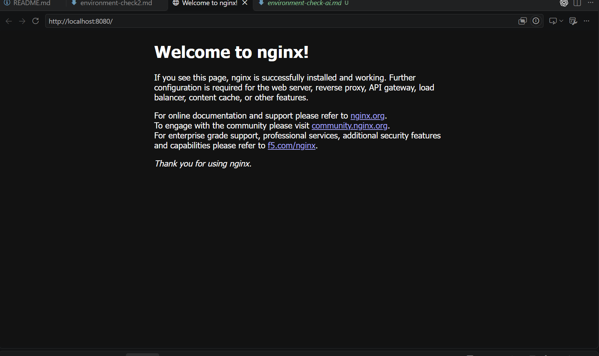

Першим встановив Cursor але на безплантій версії не дозволяє підключити Codex
Налаштував Docker, але повторював за вчителем, так і не зрозумівши як він працює 
підключив ngrok як із докером не зовсім зрозуміло як він працює, але сподіваюсь питання зникнуть помірі вивчення матеріалу
